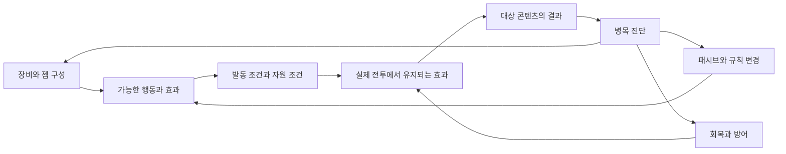

# PoE 1의 빌드 구조와 공략 축적 연구

PoE 1의 장비·스킬 기획에서 참고할 핵심은 **여러 규칙의 조합으로 빌드를 성립시키고, 병목을 찾아 다음 교체를 선택하는 구조**다. 커뮤니티는 그 과정을 최소 조건, 전환 시점, 실패 진단, 업그레이드 경로와 패치 대응 공략으로 축적한다. 이 결론은 아래 사례를 비교한 연구 해석이며, 우리 게임의 세부 사양은 [별도 확인](../../Design/Proposals/PoE1-Equipment-Skills.md)이 필요하다.

확인일은 2026년 11월 13일이다. 사용자가 지정한 기준은 [PoE 1](../../Design/Decisions/DEC-0005-poe1-reference.md)이다. [사례 기록](Community-Cases.md)과 [출처 및 버전](Sources.md)을 함께 읽는다.

현재 게임의 핵심은 [종결 장비 제작](../../Design/Decisions/DEC-0007-endgame-crafting.md)이다. 이 연구는 장비·스킬의 상호작용을 해석하는 자료로 유지하고, 제작 절차는 [PoE 2 조사](../Crafting/README.md)를 우선 사용한다.

## 규칙과 버전을 읽는 기준

GGG는 젬을 장비에 장착해 스킬을 얻고, 연결한 보조 젬으로 스킬의 행동을 바꾸는 체계를 설명한다. 공통 패시브 트리와 핵심 노드는 그 조합에 다른 규칙을 더한다. [GGG 게임 소개](https://www.pathofexile.com/game)

장비에는 기반 아이템과 옵션이 있고, 일반적인 희귀 장비의 접두·접미 옵션은 한정된 자리를 나눠 쓴다. PoEDB에서는 아이템 종류별 옵션과 개별 옵션의 적용 범위·계열을 조사할 수 있다. 이를 통해 특정 아이템을 고를 때 포기하는 다른 옵션까지 검토할 수 있다. [GGG 아이템 소개](https://www.pathofexile.com/item-data), [PoEDB 옵션](https://poedb.tw/us/Modifiers)

**버전별 규칙을 구분해야 한다.** 공식 3.29 패치에서는 젬 색상과 장비 소켓 색상이 달라도 장착할 수 있게 했고, 일치하는 유색 소켓은 퀄리티 보너스를 주도록 변경했다. 오래된 색상 요구 공략을 현재 장착 조건으로 취급하면 안 된다. 조사 시 PoEDB는 3.30을 표시했고 공식 3.30 패치 노트도 공개돼 있었다. 과거 사례는 당시 공략의 형성 과정을 보여 주는 자료로 사용한다. [GGG 3.29](https://www.pathofexile.com/forum/view-thread/3985332), [PoEDB](https://poedb.tw/kr/), [GGG 3.30](https://www.pathofexile.com/forum/view-thread/4013680)

## 빌드를 이해하는 세 가지 관점

| 관점 | 확인할 질문 | 공략에서 나타나는 형태 |
| --- | --- | --- |
| 규칙의 연결 | 어떤 효과가 누구에게 적용되고 무엇을 발동시키는가 | 젬 연결, 핵심 아이템, 패시브, 조건과 예외 |
| 성장 중 교체 | 지금 무엇이 부족하고 어느 교체부터 가능한가 | 레벨링, 전환 조건, 저예산·중간·완성 구성 |
| 지식의 축적 | 실패 원인과 새 발견이 어떻게 다음 공략에 반영되는가 | 질문, PoB 비교, 계산, FAQ, 패치 수정 |

이 연구에서 말하는 빌드의 층은 기획 문서를 분류하는 L0~L4와 다르다. 실제 빌드는 아래 요소가 서로 의존하는 관계망으로 읽는다.

| 구성 요소 | 의미 | 조사 근거 |
| --- | --- | --- |
| 기본 행동과 출력 주체 | 공격·주문·소환수 중 무엇이 실제 피해와 사건을 만드는가 | 성유물은 플레이어의 공격 명중을 받아 소환수가 주문을 발동한다. [PoEDB 성유물](https://poedb.tw/us/Summon_Holy_Relic_of_Conviction) |
| 스킬 변형과 연결 | 보조 효과의 적용 대상과 발동 제약 | 치명타 시 시전 보조는 공격과 주문을 함께 요구하며 적용할 수 없는 대상도 명시한다. 태그가 겹친다는 이유만으로 호환된다고 판단할 수 없다. [PoEDB CoC](https://poedb.tw/us/Cast_On_Critical_Strike_Support) |
| 장비와 패시브의 규칙 | 장착 아이템이 젬·소환수·자원 등에 새 조건을 부여 | Dialla는 소켓 효과를, Darkness Enthroned는 장착한 심연 주얼의 효과를 바꾼다. [Dialla](https://poedb.tw/us/Diallas_Malefaction), [Darkness Enthroned](https://poedb.tw/us/Darkness_Enthroned) |
| 빌드 성립과 유지 | 확률·회복·발동 주기를 함께 만족하는가 | 성유물의 중독 확률과 재사용 대기시간, Wardloop의 반복 유지 조건이 각각 공략의 주요 점검 항목이다. [사례 분석](Community-Cases.md) |
| 공격과 생존의 선택 | 피해를 늘릴 때 어떤 회복·방어·유지 조건을 잃는가 | RF 토론에서는 완성형 아이템을 먼저 가져와 회복 조건이 깨지는 사례를 다룬다. [RF 커뮤니티 기록](https://www.reddit.com/r/PathOfExileBuilds/comments/1f7w0z6/psa_senior_citizens_and_newbies_playing_righteous/) |
| 목적에 따른 최적화 | 특정 콘텐츠나 예산에 어떤 구성이 맞는가 | 같은 계열 안에서도 진입용·고투자·특화 구성과 교체 순서를 나눠 설명한다. [Pohx의 빌드 분기](https://pohx.net/), [성유물 교체 경험](https://www.reddit.com/r/PathOfExileBuilds/comments/1can751/what_does_the_holy_relic_upgrade_path_look_like/) |

아래는 사례들을 바탕으로 자체 정리한 관계도다. 우리 게임에 이 모든 요소를 넣기로 결정한 그림은 아니다.

## 공략은 어떻게 쌓이는가

관찰한 자료에서는 다음 정보가 반복해서 추가됐다. 모든 빌드가 같은 순서로 발전했다는 뜻이나 최초 발견자를 규명한 결과는 아니다.

1. 작동 원리와 이를 재현할 구성을 공유한다.
2. 입문 구성과 완성 구성을 나누고 전환에 필요한 조건을 적는다.
3. 따라 했지만 약하거나 작동하지 않는 사용자가 자신의 PoB와 증상을 제출한다.
4. 커뮤니티가 확률 누락, 잘못된 적용 대상, 발동 주기나 회복 부족을 찾아 설명한다.
5. 설명이 임계점 표, 교체 순서, 제작법과 FAQ로 정리된다.
6. 패치가 전제를 바꾸면 조건과 공략을 수정한다.

성유물 기록에서는 임계점 계산 질문, 장비별 교체 경험, 패시브 변경에 따른 FAQ 수정과 잘못된 스킬 진단을 확인했다. Wardloop는 계산기·중단 원인·업그레이드 목록을 공략에 함께 둔다. RF는 제작자의 안내와 커뮤니티의 진입 조건 보완을 함께 읽을 수 있었다. 날짜와 구체적인 근거는 [사례 기록](Community-Cases.md)에 정리했다.

## 오픈소스 도구에서 참고할 부분

검토한 Path of Building Community 릴리즈는 **v2.67.2**다. 프로젝트는 스킬·아이템·트리를 구성해 계산하고 공유하는 도구다. 해당 버전의 `CalcTriggers.lua`에서는 발동 주기 계산과 서버 틱 보정을 별도 처리하는 코드를 확인했다. 커뮤니티의 임계점 설명을 검토할 계산 모델로 참고할 수 있다. [PoB 저장소](https://github.com/PathOfBuildingCommunity/PathOfBuilding), [릴리즈](https://github.com/PathOfBuildingCommunity/PathOfBuilding/releases/tag/v2.67.2), [발동 계산 소스](https://github.com/PathOfBuildingCommunity/PathOfBuilding/blob/v2.67.2/src/Modules/CalcTriggers.lua)

PoB는 Lua 기반의 PoE 계산 도구이며 Unity용 패키지가 아니다. MIT 조건의 프로젝트 코드와 별도 구성요소의 조건을 확인했다. 이번에는 도구를 설치하거나 소스를 게임에 넣지 않았다. 계산을 여러 단계로 나누고 결과의 근거를 추적하는 접근이 재사용 후보이며, 실제 재사용 범위와 우리 게임 공식은 구현 전에 다시 제안한다. 해당 릴리즈의 3.30 대응은 검증하지 않았다. [PoB 라이선스](https://github.com/PathOfBuildingCommunity/PathOfBuilding/blob/v2.67.2/LICENSE.md)

## 기획에 적용할 논의 기준

제작한 장비가 빌드에서 어떤 차이를 만드는지 검토하기 위해 다음 평가 기준을 제안한다.

- 교체가 피해량뿐 아니라 행동·발동·유지 조건에 어떤 차이를 만드는지 설명할 수 있는가.
- 빌드가 성립하는 조건과 아직 부족한 조건을 추적할 수 있는가.
- 완성형을 그대로 복사하기 전에도 쓸 수 있는 구성과 교체 경로가 있는가.
- 서로 다른 조합이 다른 목표에서 의미를 갖는지 검증할 수 있는가.
- 공략이나 공유 구성을 같은 규칙 버전과 전투 조건에서 재현할 수 있는가.

이는 연구에 따른 제안이다. 실제 소켓·젬·옵션 구조, 진단 기능, 공유 기능과 수치의 채택은 [적용 논의](../../Design/Proposals/PoE1-Equipment-Skills.md)에서 확인한다.

## 조사와 실행 검증

| 구분 | 이번에 한 일 | 결과의 범위 |
| --- | --- | --- |
| 자료 조사 | PoEDB 개별 데이터, GGG 공식 설명·패치, 제작자 공략과 커뮤니티 본문·댓글 대조 | 규칙과 공략 구조에 관한 문헌 근거 |
| 코드 열람 | 고정 PoB 릴리즈의 라이선스와 발동 계산 모듈 | 구현 위치와 계산 모델의 구조 확인 |
| 문서 검사 | 프로젝트의 결정 규격, 승인 근거 필드와 문서 링크 검사 | 기록과 참조의 정합성 |
| 게임 실행 | PoE 클라이언트 실행, PoB 재계산, Unity 시뮬레이션은 수행하지 않음 | 특정 빌드의 현재 성능이나 우리 게임의 재미를 검증한 결과는 아님 |

출처별 열람 범위와 과거 공략의 제한은 [출처 목록](Sources.md)에 남겼다. 외부 자료는 링크와 자체 요약으로 기록하며 원문·이미지·데이터베이스를 복제하지 않았다.
